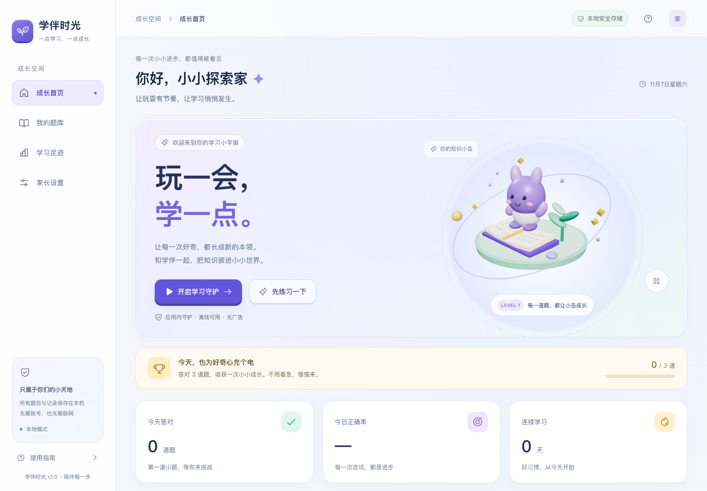
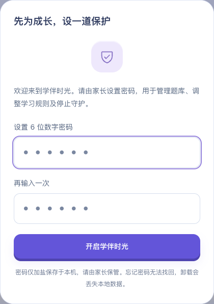
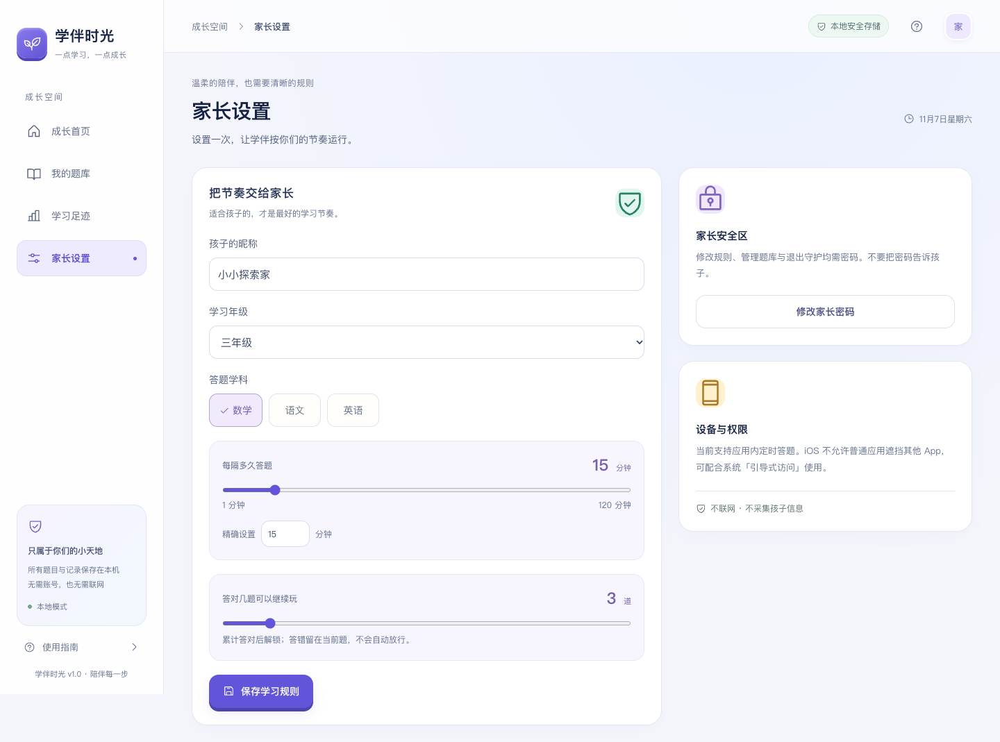
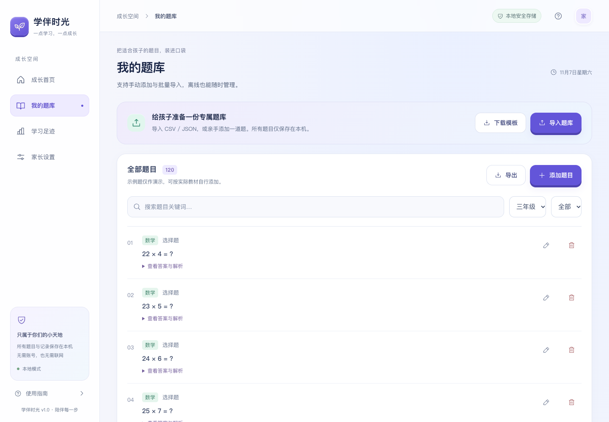
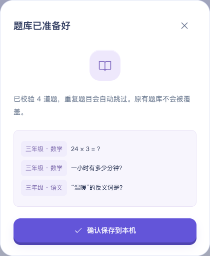
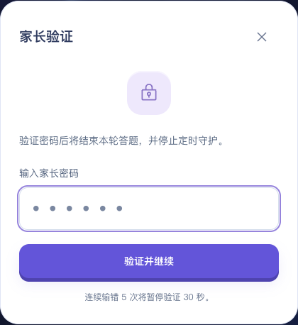
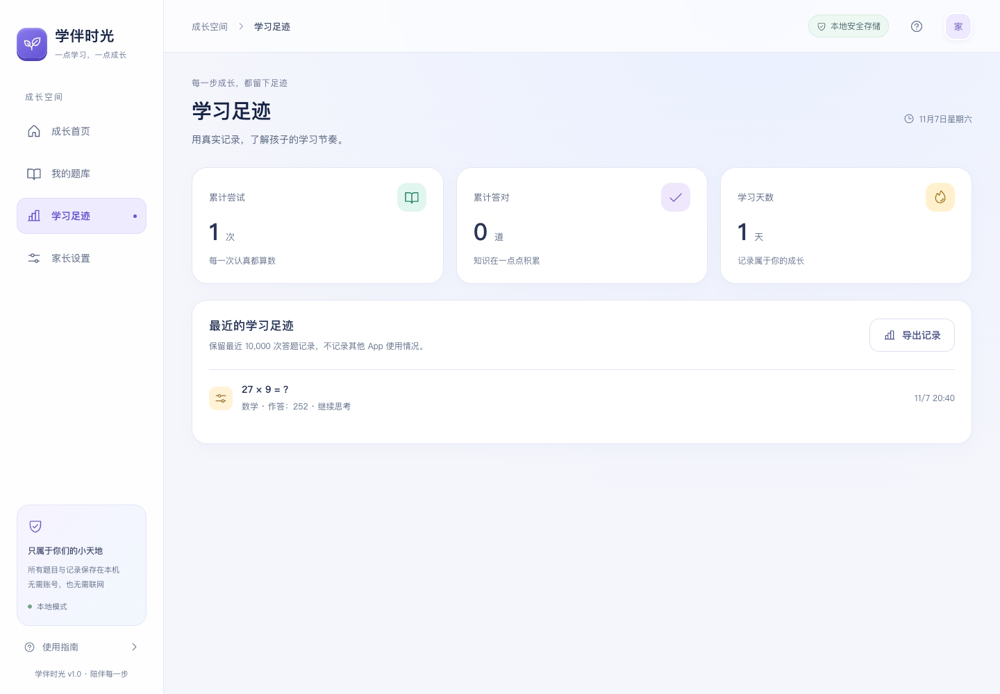
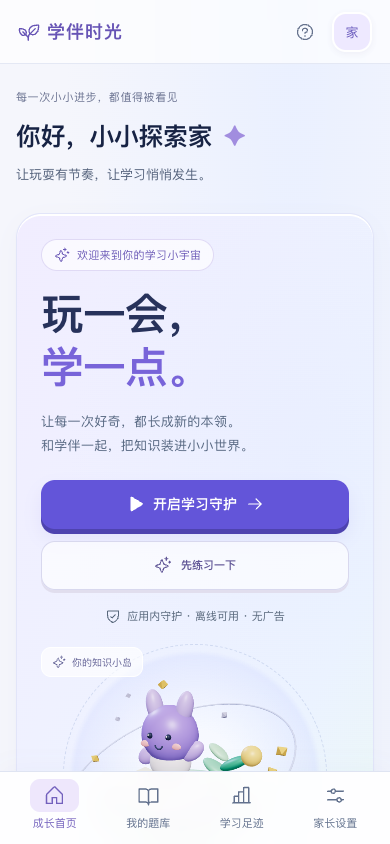

# 学伴时光 · Time Practice

**玩一会，学一点。 / Play a little. Learn a little.**

本地优先的亲子学习应用：家长管理题库和学习节奏，孩子通过答题完成一次小小探索。

A local-first learning companion: parents manage questions and learning intervals, while children practice in a playful, responsive interface.

[简体中文](#zh-cn) · [English](#english) · [构建与交付 / Build status](docs/DELIVERY.md) · [反馈 / Issues](https://github.com/chaozai0304/time-practice/issues)

**React · TypeScript · Capacitor 8 · Remotion · Three.js · Android / iOS / Web**



> **重要 / Important:** 当前是普通守护与兼容诊断版本，不是不可绕过的家长控制系统。Android 系统或厂商可隐藏浮层、强停服务；iOS/Web 仅支持应用内答题。Device Owner 强管控和 Apple Screen Time 扩展尚未实现。Installing the APK does not grant system-level device management.

<a id="zh-cn"></a>
## 简体中文

### 目录

- [项目介绍与功能](#项目介绍与功能)
- [平台支持与限制](#平台支持与限制)
- [快速启动](#快速启动)
- [使用指南与截图](#使用指南与截图)
- [题库文件格式](#题库文件格式)
- [构建安装包](#构建安装包)
- [开发与验证](#开发与验证)
- [数据安全与常见问题](#数据安全与常见问题)
- [参与贡献与许可](#参与贡献与许可)

### 项目介绍与功能

学伴时光希望帮助家庭建立“玩耍—学习—继续探索”的节奏。所有题目、设置和记录保存在本机，不需要账号、服务器或 API Key。**文档提供中英文，当前应用界面主要为中文。**

- **本地题库**：1–6 年级，数学、语文、英语；内置 120 道原创演示题，并非完整教材。支持手动增改删、搜索、CSV/JSON 导入、预览、校验、去重与备份。
- **学习规则**：间隔 1–120 分钟，每轮累计答对 1–20 道；答错留在当前题，应用内没有跳过或自动超时放行按钮。
- **独立练习**：先体验答题，不启动跨应用守护。支持选择题、填空题，随机题序和选项；规范化全角数字、空格与英文大小写。
- **家长验证**：自行设置 6 位密码，无默认密码；随机盐和 PBKDF2-HMAC-SHA256（120,000 次），不保存明文。连续输错 5 次暂停验证 30 秒。
- **成长足迹**：真实答题统计、连续学习天数、每周图表和最近 10,000 次答题记录；支持导出。
- **自适应视觉**：软 3D 学习小岛、全屏宇宙答题背景、透明题目层、清晰按钮和过关纸屑。Remotion + Three.js 动画支持暂停、减少动态效果、后台停播及静态降级。
- **Android 1.2 兼容诊断**：原生计时服务、答题浮层、普通原生答题入口、页面内家长数字键盘、后台权限提示与不含密码/题目的运行诊断。

### 平台支持与限制

| 平台 | 支持内容 | 不能保证的能力 |
| --- | --- | --- |
| Android 8+ / API 26+ | 原生前台计时、经授权的跨应用浮层、普通原生答题页、本地管理 | 无法阻止系统强停、卸载、重启或厂商清理；后台显示依赖系统许可与策略 |
| iOS / iPadOS 15+ | iPhone/iPad 原生工程、应用内答题、本地题库和记录 | 尚无 Family Controls / ManagedSettings / DeviceActivity 扩展，不能拦截其他 App |
| Web | 桌面、手机、平板浏览器中的题库、规则、练习和应用内计时 | 网页不能遮挡其他应用；后台计时可能受浏览器限制 |

计时包含息屏时间，不是“实际游戏使用时长”的统计。Android 使用单调时钟；Web/iOS 保存截止时间并在回到前台时校验。浏览器刷新不会重新获得完整玩耍时间。

已读取到荣耀 Android 14 真机的系统管家 **force-stop** 记录：进程和服务被结束，普通权限不能阻止。不能把“窗口已挂载”“回到 App 后弹题”或“虚拟测试通过”当作可靠后台拦截。详见 [荣耀权限、复测与诊断指南](docs/ANDROID_HONOR.md)。

### 快速启动

需要 **Node.js 22.12+** 和 npm；首次安装依赖需联网，运行时不需要服务器或密钥。

```bash
git clone https://github.com/chaozai0304/time-practice.git
cd time-practice
npm ci
npm run dev
```

在电脑浏览器打开开发服务显示的本地地址，默认 `http://127.0.0.1:5173/`。使用响应式预览可以查看手机和平板布局；这不是原生设备拦截演示。

### 使用指南与截图

**截图说明**：以下图片均由电脑上的真实网页界面生成，使用隔离的演示数据，不来自平板或孩子的实际记录。它们展示操作位置和布局，不证明 Android 后台拦截。动画会根据设备能力显示 3D 或静态回退。

#### 1. 家长设置密码

首次打开会出现保护设置页。输入两次相同的 **6 位数字密码**，点击“开启学伴时光”，进入首页。密码由你自己设置，截图和测试中的演示数据不是默认密码。请妥善保管，当前没有云端找回功能。



#### 2. 调整学习规则

首页点击右上角家长头像或“家长设置”，先验证密码。设置昵称、年级、学科、答题间隔和过关题数，点击“保存学习规则”并再次验证。**守护运行中须先停止，才能修改规则、题库和密码。**



#### 3. 准备或导入题库

进入“我的题库”并验证密码。可以点“添加题目”手动填写；也可先下载模板，按格式编辑 CSV/JSON，再点“导入题库”、验证密码并选择文件。



应用先校验并显示预览，确认题目数量与内容后点击“确认保存到本机”。不会上传到服务器，也不会覆盖原题；重复题会跳过。



模板：[CSV](examples/questions.csv) · [JSON](examples/questions.json)。导出文件包含正确答案，请由家长保管。

#### 4. 练习或开启守护

- **“先练习一下”**：马上开始一次应用内练习，不启动后台跨应用守护，适合首次体验。
- **“开启学习守护”**：按规则开始计时。Android 需家长授权浮层、通知并允许后台活动；Web/iOS 只在应用内答题。
- 首次测试建议设为 **1 分钟**，家长陪同检查。Android 切换其他 App 后应自动出现题目，**返回学伴或手动点通知后才出现，不算后台验收通过**。

到期或练习时，选择一个选项，或在填空框填写答案，点击“确认答案”。答错继续当前题；累计答对目标题数后，练习结束，普通守护开始下一轮。宇宙背景可暂停，不影响答题。


#### 5. 家长停止守护

首页点击“家长停止守护”，或答题页点“家长退出”，验证正确密码后停止。取消验证会返回答题，不会停止守护。



上图是 **网页验证页**；Android 1.2 使用独立原生页面与页面内数字键盘，避免唤起系统输入法，本图不展示该原生页面。停止守护不等于强杀进程，iOS 不提供应用自行强退能力。

#### 6. 查看记录与备份

进入“学习足迹”查看实际尝试和正确率；点击“导出记录”并验证密码进行备份。题库备份则在“我的题库 → 导出”。截图中的一条记录来自采集过程中实际完成的一次演示作答。



#### 手机布局

相同功能会适配窄屏，底部导航提供首页、题库、足迹与家长设置入口。截图为浏览器 `390 × 844` 视口，并非手机系统截图。



### 题库文件格式

| 字段 | 要求 |
| --- | --- |
| `grade` | 整数 1–6 |
| `subject` | `数学` / `语文` / `英语` |
| `prompt` | 题干，1–1000 字符 |
| `options` | JSON 字符串数组；CSV 用 `\|` 分隔；留空或 `[]` 表示填空题 |
| `answer` | 1–160 字符；选择题填选项的完整文字，**不是 A/B/C/D** |
| `explanation` | 可选解析，家长在题库中查看；答错时不直接展示 |

单文件最多 **5 MB**，每批 **1–2000 道**，本地最多 **5000 道**。一条无效会拒绝整批并提示题号；按年级、学科、题干、选项和答案去重。填空按规范化后的文字精确匹配，不支持多个等价答案或复杂表达式求值。当前不支持照片 OCR、PDF/Word 自动识题。

### 构建安装包

#### Android APK

准备 **Java 21、Android SDK Platform 36、匹配 Build Tools** 和更新的系统 WebView。本人确认 SDK 许可后，配置 `ANDROID_HOME`，或在不提交的 `android/local.properties` 中设置 `sdk.dir`。

```bash
npm run android:apk
```

脚本先构建并同步资源，再运行原生单测与 `assembleDebug`。成功产物：`android/app/build/outputs/apk/debug/app-debug.apk`。调试包可测试安装，不是商店正式发布包。更新同签名版本建议**覆盖安装，不要先卸载**。

仓库不提交 APK、IPA、构建缓存或签名材料。也可在 [GitHub Actions](https://github.com/chaozai0304/time-practice/actions) 的 **Android 构建成功后**下载 `sprout-android-debug-apk` 产物；这里不承诺工作流已成功或存在已发布安装包。

默认 Gradle 缓存为 `build/gradle-home/`，不改用户全局初始化脚本；已有 `GRADLE_USER_HOME` 时遵循该配置。正式发布需自有 release 签名、真机验收及商店审核；`specialUse` 前台服务需申报，不保证审核通过。

#### iOS / iPadOS

准备 **macOS、Xcode 26+、iOS 平台组件**，工程为 `ios/App/App.xcodeproj`，使用 Swift Package Manager。执行 `npm run sync` 和 `npm run ios:open`，在 Xcode 选择自己的 Team 并配置签名，然后真机 Run 或 Archive / Distribute。

`npm run ios:check` 是无签名编译检查；`npm run ios:archive` 尝试生成待签名归档。**两者不等于可安装 IPA**，没有证书、描述文件和分发条件不能生成通用安装包。本机历史构建受平台组件与签名阻塞，状态见 [交付记录](docs/DELIVERY.md) 和 [Xcode 配置指南](docs/IOS_SETUP.md)。

### 开发与验证

| 命令 | 用途 |
| --- | --- |
| `npm run dev` | 本地网页开发 |
| `npm run build` | TypeScript 校验与生产构建，输出 `dist/` |
| `npm test` | 状态机、导入、存储和密码单测 |
| `npm run lint` | 代码规范检查 |
| `npm run test:e2e` | 桌面 / 手机 / 平板浏览器流程测试 |
| `npm run docs:screenshots` | 隔离浏览器演示，重建 `docs/screenshots/` 图片；需要 Google Chrome |
| `npm run docs:verify` | 只读检查 README 链接、语言锚点、截图和 Git 发布文件的常见敏感模式 |
| `npm run sync` | 构建并同步 Android/iOS 资源，不安装到设备 |
| `npm run android:open` / `npm run ios:open` | 打开原生 IDE 工程 |
| `npm run motion:studio` | Remotion 时间轴，默认端口 3001 |
| `npm run icons:generate` | 生成 Android/iOS 图标 |

浏览器测试需 Google Chrome，使用生产预览并串行覆盖 `1440 × 1000`、`390 × 844`、`1024 × 768`。Apple Silicon 可通过 `scripts/chrome-arm64.sh` 使用原生 ARM Chrome；复制源码丢失权限时运行 `chmod +x scripts/chrome-arm64.sh`。截图脚本使用电脑本地端口 4175，结束后关闭预览，不使用 ADB 或真实设备数据。

不要重复运行 `cap add`，否则可能覆盖自定义原生代码。应用无需 API Key 或运行时环境变量，不需要 `.env`。

**代码导航**：`src/lib/` 为题库、会话、密码和存储逻辑；`src/components/` 为交互界面；`src/motion/` 为动画；`android/app/src/main/java/com/sprout/timepractice/` 为原生服务、答题页面、桥接与密码验证；`tests/` 为网页测试。

### 数据安全与常见问题

- **离线与隐私**：题库、昵称、答题记录、密码派生值仅在本机；无账号、服务器、广告、埋点或外部字体，不统计其他 App 内容或使用记录。Android 关闭自动备份；iOS 数据可能随用户设备备份保存。
- **忘记密码怎么办？** 没有云端找回或后门。卸载、清除数据或浏览器存储会删除本地内容，建议定期导出题库和记录，不能靠反复重装修复系统强停。
- **后台不弹题怎么办？** 检查后台活动、电池限制、通知和浮层权限，并导出运行诊断；窗口挂载并不证明系统让它可见。荣耀上滑清理已出现系统级强停，普通 APK 无法保证恢复或防退出。
- **Device Owner 是否已经支持？** 尚未实现。仅安装 APK 或开启普通设备管理员不等于系统级强管控；未来启用需另行开发、明确授权、检查设备条件和验收。
- **iOS 能拦截其他 App 吗？** 当前不能。引导式访问可以由家长自行配置用于应用内场景；跨应用能力需另行开发 Apple Screen Time 扩展并取得授权。
- **测试通过是否代表真机可用？** 不代表。网页/JVM 回归不证明厂商后台策略、实际输入法或系统窗口合成行为。发布前须在目标设备验证，并保留紧急功能和系统安全能力。

更多：[平台与签名边界](docs/CROSS_PLATFORM.md) · [荣耀诊断](docs/ANDROID_HONOR.md) · [构建与验证记录](docs/DELIVERY.md) · [设计规范](design-system/sprout/MASTER.md)。

### 参与贡献与许可

欢迎通过 [Issues](https://github.com/chaozai0304/time-practice/issues) 提交问题或通过 Pull Request 改进。请附应用版本、系统版本、复现步骤及**脱敏**截图/诊断；不要上传密码、密码哈希、密钥或孩子的真实题库和学习记录。提交前运行单测、Lint 和构建，涉及交互时补充浏览器测试。

本应用主体**尚未声明开源许可证**，公开可见不等于授予任意使用、复制或分发许可；请先与维护者确认。第三方依赖分别遵循各自的许可证；附带 `ui-styling` 工具保留其 [Apache 2.0 许可证](.github/prompts/ui-styling/LICENSE.txt)。

<a id="english"></a>
## English

### Overview

**Time Practice (学伴时光)** is a local-first parent–child learning companion built with React, TypeScript and Capacitor 8. Parents configure learning intervals and maintain an offline question library. Children answer questions in a playful interface featuring Remotion and Three.js animations.

No account, backend or API key is required at runtime. **The documentation is bilingual; the application UI is currently primarily in Chinese.** This is a regular guard/compatibility-diagnostics build, **not a tamper-proof parental-control system**.

### Features and platform support

- Grades 1–6; mathematics, Chinese and English; 120 original demonstration questions, not a complete curriculum.
- Configurable 1–120 minute intervals and 1–20 correct answers per round. Incorrect answers stay on the current question; no in-app skip or timeout bypass.
- Separate practice mode, multiple-choice and text-answer questions, shuffled questions/options and normalized answer comparison.
- Local question editing, CSV/JSON import with validation, preview and deduplication, and question/record exports.
- Parent-created six-digit PIN, salted PBKDF2-HMAC-SHA256 with 120,000 iterations, and a 30-second verification cooldown after five failures. No default PIN or cloud recovery.
- Responsive desktop/tablet/phone layouts, learning statistics, a 3D learning island and full-screen universe quiz background, animation pause and reduced-motion/static fallbacks.
- Android 1.2 native timer, application overlay, ordinary quiz Activity, inline parent keypad and diagnostics that exclude PINs, questions and answers.

| Platform | Supported | Important limitation |
| --- | --- | --- |
| Android 8+ / API 26+ | Native foreground timer and permission-dependent cross-app overlay/quiz entry | The OS or OEM can hide windows or force-stop the app; uninstall/reboot/cleanup cannot be prevented by this build |
| iOS / iPadOS 15+ | Native project, local library and in-app quizzes | No Family Controls / ManagedSettings / DeviceActivity extensions; no cross-app interception |
| Web | Responsive local library, practice and in-app timer | A website cannot block other apps; browser background scheduling is restricted |

Elapsed time includes screen-off time; it is not a measurement of actual gameplay. Android uses a monotonic clock; Web/iOS persist deadlines and recheck on returning to the foreground. An observed Honor Android 14 system-manager force-stop ended the native service. A successful browser test, attached window or quiz shown only after reopening the app is **not** proof of reliable background guarding.

### Quick start

Install Node.js 22.12+ and npm, then clone this repository, run `npm ci`, and start `npm run dev`. Open the local URL printed by Vite, normally `http://127.0.0.1:5173/`. Dependency installation requires network access; the application itself is local-first.

### Usage and screenshot walkthrough

All screenshots are **real browser captures with isolated demonstration data**, not Android/iOS system screenshots or evidence of cross-app blocking. The same images are shown in the Chinese walkthrough above.

| Step | What to do in the UI | Screenshot |
| --- | --- | --- |
| 1. Create a parent PIN | Enter your own six-digit PIN twice, then select “开启学伴时光”. Keep it private; no default PIN exists. | [Welcome / PIN setup](docs/screenshots/01-welcome.png) |
| 2. Configure learning | Open “家长设置”, verify the PIN, choose grade/subjects/interval/target, then save and verify again. Stop guarding before editing. | [Parent settings](docs/screenshots/03-settings.png) |
| 3. Prepare questions | Open “我的题库”. Add questions manually, or download a template and use “导入题库” to select CSV/JSON. | [Local library](docs/screenshots/04-library.png) |
| 4. Confirm import | Review the validated preview and select “确认保存到本机”. Existing questions are retained and duplicates are skipped. | [Import preview](docs/screenshots/05-import.png) |
| 5. Practice or guard | “先练习一下” starts immediate in-app practice, not background guarding. “开启学习守护” starts the configured timer. Android needs overlay/notification/background permissions. | [Home](docs/screenshots/02-home.png) |
| 6. Answer questions | Select an option or enter a text answer, then select “确认答案”. Incorrect answers remain; reaching the correct-answer target completes the round. | [Universe quiz](docs/screenshots/06-quiz.png) |
| 7. Parent exit | Select “家长停止守护” on Home or “家长退出” in the quiz. A correct PIN stops guarding; cancelling verification does not. | [Web parent verification](docs/screenshots/07-parent.png) |
| 8. Review and back up | Open “学习足迹” and export records after PIN verification. Export the question library separately from “我的题库”. | [Learning records](docs/screenshots/08-records.png) |
| 9. Use a narrow screen | The layout adapts and offers bottom navigation. This capture uses a 390 × 844 browser viewport. | [Mobile layout](docs/screenshots/09-mobile.png) |

The parent-verification image shows the **web dialog**. Android 1.2 instead uses a separate native Activity with an inline numeric keypad; that native screen is not pictured. The records capture contains one attempt genuinely made during the demonstration.

For a first guard test, use a one-minute interval with a parent present. Android should show the quiz without reopening the app or tapping a notification; requiring those actions is a failed background test. OEM settings may still prevent this. This build has no Device Owner/DPC lock-task enforcement; installing an APK alone cannot activate device management.

### Question file format

Download [CSV](examples/questions.csv) or [JSON](examples/questions.json). JSON uses an array of question objects; CSV uses a header row.

| Field | Requirement |
| --- | --- |
| `grade` | Integer 1–6 |
| `subject` | One of the exact values `数学`, `语文`, `英语` |
| `prompt` | Question text, 1–1000 characters |
| `options` | JSON string array, or CSV options separated by `\|`; empty/`[]` means a text-answer question |
| `answer` | 1–160 characters; for multiple choice, use the **full option text**, not A/B/C/D |
| `explanation` | Optional explanation for parents; not directly revealed after a wrong answer |

Limits: 5 MB per file, 1–2000 questions per import, 5000 stored questions. One invalid question rejects the batch with an error. Text answers use normalized exact matching; OCR, PDF/Word extraction, alternative equivalent answers and complex expression evaluation are not supported.

### Build, test and screenshots

Use the command reference above for all scripts. Typical checks are `npm test`, `npm run lint`, `npm run build` and `npm run test:e2e`. Browser tests require Google Chrome and cover desktop, phone and tablet viewports sequentially. Apple Silicon uses the existing ARM Chrome wrapper when available.

Run `npm run docs:screenshots` to regenerate the walkthrough in an isolated local browser. It uses port 4175, closes its preview on completion, never accesses a tablet and never uses real user data. Do not repeat `cap add`: the Android/iOS directories already contain custom native code. No runtime `.env` file is required.

**Android:** prepare Java 21, Android SDK Platform 36 and matching Build Tools, accept SDK licenses yourself and configure `ANDROID_HOME` or an ignored `android/local.properties`. Run `npm run android:apk`; the debug APK is produced at `android/app/build/outputs/apk/debug/app-debug.apk`. Same-signed updates should be installed over the old version, without uninstalling first. Release distribution requires your own signing key, device validation and applicable store approval.

**iOS/iPadOS:** prepare macOS, Xcode 26+, iOS platform components and your signing team. Run `npm run sync` and `npm run ios:open`, then configure signing in Xcode and use Run or Archive / Distribute. `ios:check` is unsigned compilation; `ios:archive` attempts a signing-ready archive. Neither is an installable IPA. See [build status](docs/DELIVERY.md), [Xcode setup](docs/IOS_SETUP.md) and [cross-platform limitations](docs/CROSS_PLATFORM.md).

APK/IPA binaries, caches, device diagnostics and signing material are not committed. An APK can also be downloaded from [GitHub Actions](https://github.com/chaozai0304/time-practice/actions) **after** its Android job succeeds; this does not claim an existing successful build or released download.

### Privacy, troubleshooting and contributions

Questions, nicknames, attempts and derived PIN values stay on the device. There are no ads, analytics or external fonts; other-app content/use is not tracked. Android automatic backup is disabled, while iOS data may be included in the user's own device backup. Exported files contain answers or learning records and should be protected by parents.

Uninstalling or clearing app/browser data deletes local content. Export backups regularly. Reinstalling cannot fix an OS force-stop or automatically grant Device Owner privileges. Native/JVM and browser tests do not validate OEM background policies, real keyboards or device window composition. Emergency and system-safety capabilities remain available.

Report bugs through [Issues](https://github.com/chaozai0304/time-practice/issues) with app/OS versions, reproduction steps and redacted screenshots/diagnostics. Do not submit PINs, PIN hashes, credentials or a child's real question library/learning records. Pull requests should include relevant tests and pass unit tests, lint and build.

**License:** no open-source license has been declared for the main application yet. Public visibility does not grant unrestricted permission to use, copy or distribute it; contact the maintainer first. Third-party dependencies retain their respective licenses; the bundled `ui-styling` tooling retains its [Apache 2.0 license](.github/prompts/ui-styling/LICENSE.txt).