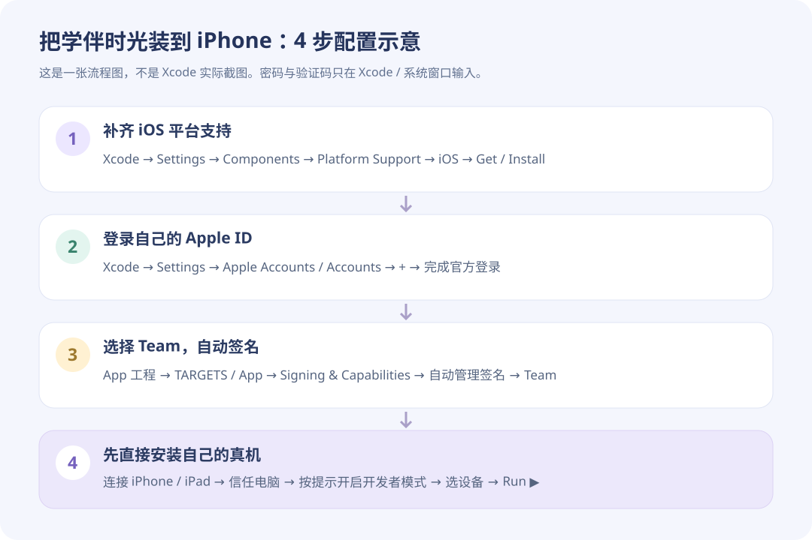

# iPhone / iPad 安装：按顺序点，不需要手工制作证书

## 先看清楚：哪些我能做，哪些必须你本人做

- 已有 iOS 工程、应用图标、离线题库和动画资源，不需要另写一个 iOS App。
- 已确认 Xcode 主程序和 iOS SDK 路径存在，依赖已下载；但 Xcode 报告 iOS 26.5 平台目标不可用。首次初始化和原生 ARM 查询都已检查，不能靠修改应用代码掩盖这个错误。
- 已执行 Apple 官方组件检查 `xcodebuild -runFirstLaunch -checkForNewerComponents`，返回 `No new updates for 17F113`，没有自动补齐设备归档目标。下面的 Components 与账号配置仍须在 Xcode 中确认。
- 本机目前 **0 个有效代码签名身份**。Apple ID 登录、两步验证、条款或系统管理员密码，只能由你在 Xcode / 系统窗口输入，**不要发给聊天助手**。

## 1. 打开工程

运行项目的 `npm run ios:open`，或在 Finder 打开 `ios/App/App.xcodeproj`。等待 Xcode 左上角的依赖加载结束。

## 2. 补齐 iOS 平台支持

1. 在屏幕最顶部菜单点击 **Xcode → Settings…（设置）**。
2. 左边点击 **Components（组件）**。
3. 找到 **Platform Support（平台支持）** 里的 **iOS**，点击 **Get / Install（获取 / 安装）**。
4. 等下载和安装完成。不要只安装 “Other Installed Platforms” 中的模拟器运行时；模拟器和设备平台支持是两类组件。
5. 如果系统弹出管理员确认，你自己在系统窗口里确认。不能在聊天中输入管理员密码。

成功标志：工程顶部的运行设备可以选到 **Any iOS Device (arm64)**，连接手机后还能看到你的 iPhone / iPad，而不是 `iOS 26.5 is not installed`。

## 3. 登录你自己的 Apple ID

1. 仍在 **Xcode → Settings…**，左边选择 **Apple Accounts / Accounts（Apple 账户 / 账户）**。
2. 点 **+** 或 **Add Apple Account**。
3. 在 Xcode 的官方登录窗口里输入你的 Apple ID，按提示完成双重认证。
4. 登录后能看到你的账户；如果还没加入付费开发者计划，一般会看到自己的 **Personal Team（个人团队）**。

这里不用把证书下载出来，也不用给助手发送账号、验证码、证书口令或私钥。

## 4. 选 Team，让 Xcode 自动处理签名

1. 关闭设置窗口。
2. 在工程左侧最上方点击蓝色的 **App 工程图标**。
3. 中间 **TARGETS** 下面选择 **App**，不是 PROJECT，也不是某个依赖包。
4. 点击上方 **Signing & Capabilities（签名与能力）**。
5. 勾选 **Automatically manage signing（自动管理签名）**。
6. 在 **Team** 下拉框选择你的团队 / Personal Team。
7. 如果显示 Bundle Identifier 已被使用，将它改成自己独有的反向域名，例如 `com.你的英文名.sproutstudy`；不要使用别人的标识符。

成功标志：没有红色的 “Signing requires a development team”，并出现 Apple Development 签名信息。Xcode 可能需要短时间联网创建开发描述文件。

## 5. 最简单的方法：直接装到你自己的 iPhone / iPad

1. 用数据线连接设备，设备弹出提示时点击 **信任这台电脑**。
2. 按设备提示开启 **设置 → 隐私与安全性 → 开发者模式**，若要求重启则重启并确认。
3. 在 Xcode 顶部设备下拉框选择你的真机。
4. 点击左上角 **▶ Run**。首次安装可能需要在手机 **设置 → 通用 → VPN 与设备管理** 中按系统提示信任你的开发身份。

仅在自己设备上试用，可先使用 Apple 允许的免费 Personal Team 路径；这不等于获得可任意分发的 IPA，免费签名和设备/期限受 Apple 限制。

## 6. 什么时候才需要导出 IPA？

- 只装自己的手机：优先按第 5 步直接 Run，更简单。
- 想发给别人的 iPhone、用 TestFlight 或上架：需要匹配的 Apple Developer Program 资格与分发方式，不能把安卓的 APK 发送安装方式原样照搬。
- 具备相应资格后，在 Xcode 选择 **Product → Archive → Distribute App**，根据实际用途选择 Development、Ad Hoc、TestFlight 或 App Store Connect。不同方式需要对应设备登记、描述文件或审核。

## 配置后告诉我什么？

只需说“已登录、已选 Team、能看到真机 / Any iOS Device”。不要发送任何密码或验证码。我就可以重新检查签名与归档，并继续生成符合你分发方式的产物。

官方组件说明：https://developer.apple.com/documentation/xcode/downloading-and-installing-additional-xcode-components